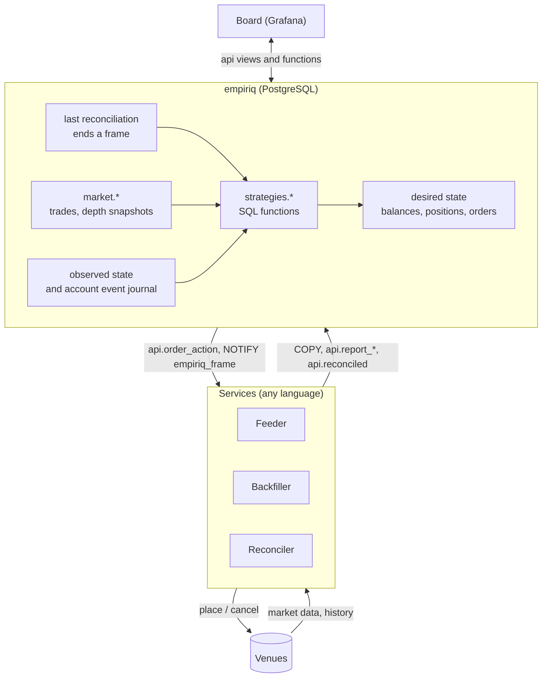
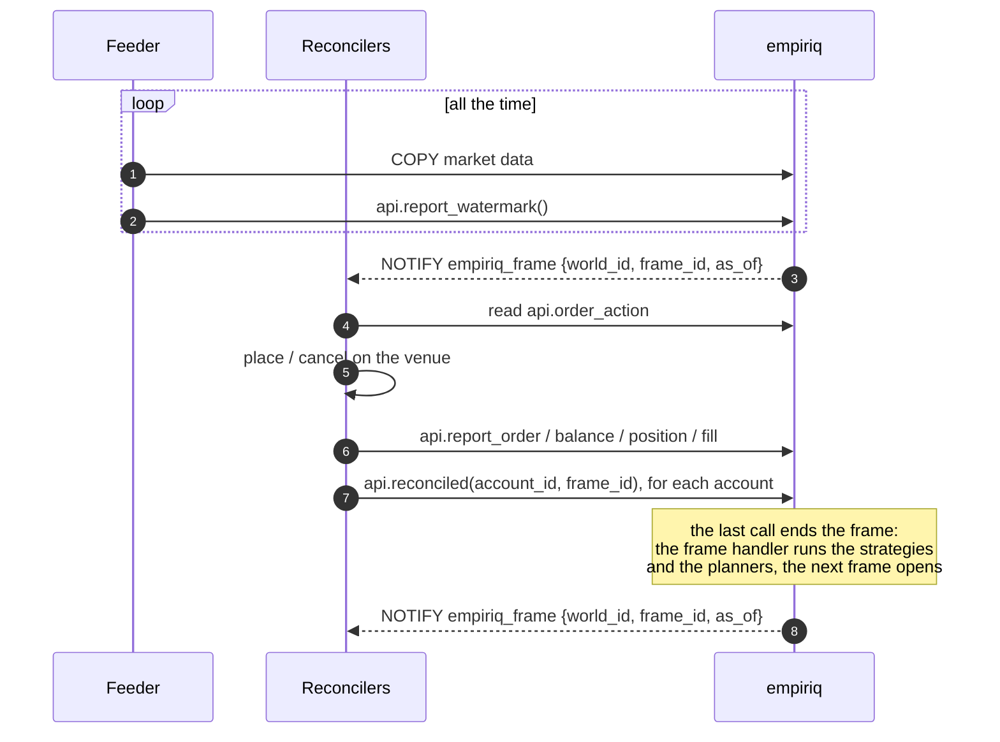
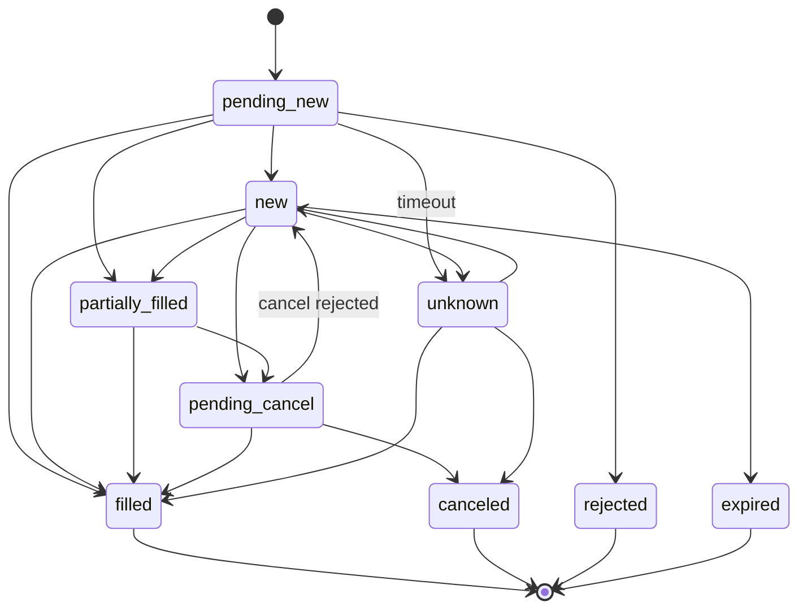

# Architecture

> Status: **draft**. Names, tables and functions will change before the first release.
> Decisions with lasting impact are recorded as [ADRs](../adr/README.md).

empiriq is an algorithmic trading platform built around PostgreSQL. The
database holds the current state of every trading account. It also holds the
market data for these accounts. Strategies are SQL functions. Feeders,
backfillers, reconcilers and the board are separate
[services](#services). They communicate only with the database.

**Designed for:** decisions within one second or faster. Examples are market
making, arbitrage between venues, intraday strategies and portfolio
rebalancing. Backtests and research run the same code as live trading.

**The database is an investment, not only a cost.** PostgreSQL in the
decision loop adds some latency compared with an in-process engine. In return,
you get these benefits:

- The database stores every event, and you can query it later. The history for
  backtests and analysis grows while you trade.
- SQL processes large volumes of trades and depth snapshots next to the data.
  The application does not have to load the data first.
- Account state is transactional. It survives a restart of any component.
- Strategies, the board and one-off analysis use the same data.

**Not a goal:** high-frequency trading (HFT) where microseconds decide, for example
with co-location or kernel bypass. A frame takes a few transactions, so the
latency budget is in milliseconds.

## Big picture



The `database` service holds the database, in the `database` repository.
The other services have their own repositories, and they use only the public `api`
schema. See [Services](#services).

| Schema       | Purpose                                                        | Stability |
|--------------|----------------------------------------------------------------|-----------|
| `api`        | Public contract: views, functions, types                       | Versioned. Breaking changes only in major versions |
| `market`     | Market data tables that feeders write (bulk `COPY` / `INSERT`) | Versioned like `api` |
| `strategies` | User strategy functions                                        | Owned by the user |
| `core`       | Internal tables and the engine                                 | Not stable. Do not depend on it |

## Desired state and observed state

This is the central idea. It comes from Kubernetes controllers:

- **Observed state** is what the venue reports: balances, positions, orders and
  fills. Only reconcilers write it, through `api.report_*`.
- **Desired state** is what strategies want. Only the engine writes it, from
  strategy output.
- **Reconciliation** is the job of the reconciler: it makes the observed state
  match the desired state.

Strategies never call a venue. They never write observed state. Reconcilers
never make trading decisions. Because of this split, you can test strategies
in isolation, and backtests are reliable. One reconciler can also serve many
strategies.

## Frames

A **world** is a set of accounts with one clock. A **frame** is
one step of a world at one `as_of`. The last reconciler of the world ends the
frame ([ADR 0022](../adr/0022-frames-belong-to-a-world.md)).

> **Not implemented yet.** Today each reconciliation of an account starts the
> frames of the strategies on that account ([ADR 0008](../adr/0008-frames.md)).



1. Feeders write the streams of the active live requests all the time.
   For each stream they also send a heartbeat with `api.report_watermark()`,
   also when the market is quiet.
2. The database opens a frame of a world. `NOTIFY empiriq_frame` sends its id
   and `as_of` to the reconcilers.
3. Each reconciler sends the order actions to the venue and reports the
   observed state. Every report also goes into the account event journal.
   Then it calls `api.reconciled(account_id, frame_id)` for each of its
   accounts in the world.
4. The last call ends the frame. In its transaction, the frame handler runs
   the running strategies of the world and the planners. Then the next frame
   opens, and its `NOTIFY` sends the new desired state to the reconcilers.

This design has these consequences:

- **No scheduler.** The slowest reconciler of a world sets its rhythm. In a
  replay world, the simulated reconcilers respond at once, so the world runs
  as fast as the database.
- **One `as_of` for all accounts of a world.** A strategy sees all accounts
  of its world at the same `as_of`. This is what arbitrage between venues
  needs.
- **The slowest venue sets the rhythm** for all strategies of its world.
- **Every frame needs every reconciler.** A reconciler calls
  `api.reconciled()` also when the venue did not respond. A reconciler that
  stops or hangs stops its world (open question 1).
- **Quiet markets.** Frames also run when no new data arrived. A stale
  heartbeat shows a broken feeder. Its detection belongs to the container
  level.
- **Isolation.** Each strategy runs in its own subtransaction. If a strategy
  fails, it keeps its previous desired state. `api.frame` shows the error.
- **Order.** `as_of` increases for each world. The next frame of a world
  opens only when the previous one ends.

The frame handler runs in the transaction of the last `api.reconciled()`.
This is simple and atomic. But a slow strategy also makes that reconciler
slow. See the open questions.

## Time and determinism

A strategy never calls `now()`. Its logical time is `ctx.as_of`. `api.now()`
returns the same value from a setting that the engine sets for the
transaction. The helper functions use two rules for visibility:

- Market data is visible only after the venue **published** it:
  `event_time <= as_of`. The `trade_time` of a trade (when it happened) only
  puts the trade into a period. It never controls visibility.
- Inside a frame, the **writer** of the row decides
  ([ADR 0009](../adr/0009-writers.md)). Every row has a writer: a feeder or a
  backfill run. If the writer was open at frame start, the row is visible
  only if its `seq` is not higher than the **cutoff** of that writer: its
  highest `seq` at frame start. If the writer was closed before frame start,
  all its rows are visible. Rows of a writer that started later are invisible.

The second rule makes frames repeatable. A trade can arrive in the database
after a frame, although its `event_time` is before `as_of`. The frame did not
see it. A replay with the same cutoffs does not see it either. This is true
also when a feeder and a backfiller write the same stream at the same time.

A strategy builds its bars from `api.trades()`
([ADR 0013](../adr/0013-strategies-build-bars.md)). It must use only periods
that are **closed** at `as_of`. A period that starts at `ts` is complete only
at `ts + interval`. The [market data reference](../reference/market-data.md)
has the details.

So a strategy is a pure function of its inputs: visible market data, observed
state, params and strategy state. For this reason, backtests and live trading
use **the same code**. The clock is a property of the world:

| Clock      | Accounts                                             | `as_of`                                      | Cutoffs  | Market data                      |
|------------|------------------------------------------------------|----------------------------------------------|----------|----------------------------------|
| `live`     | Real venues, or simulated accounts for paper trading | Wall clock                                   | Recorded | Feeders, real time               |
| `replay`   | Simulated fills against history                      | The previous `as_of` + the step of the world | None     | Backfillers, before the backtest |

A backtest needs no feeder. Request the history with `api.add_history_request()`
before the backtest starts, and backfillers load it into `market.*`. Then the
replay world moves `as_of` step by step, and its simulated reconcilers
respond at once. History does not change during a backtest, so `event_time <= as_of`
alone is deterministic.

## Declarative state: three intent levels

A strategy can state what it wants at one of three intent levels:

| Intent level | Constructor                                          | Meaning                                  | Table                   |
|--------------|------------------------------------------------------|------------------------------------------|-------------------------|
| **balance**  | `api.target_balance('BTC', 0.5, 'USDT')`             | Hold 0.5 BTC. Convert from and to USDT.  | `core.desired_balance`  |
| **position** | `api.target_position(instrument, 2)`                 | Hold a net position of +2.               | `core.desired_position` |
| **order**    | `api.limit_order('bid-1', instr, 'buy', 0.1, 64000)` | This exact order must exist.             | `core.desired_order`    |

**Planners** convert balance and position intents into orders. A planner
calculates the delta: `target − observed − in-flight`. If the delta is larger
than the tolerance, the planner adds a desired order with
`origin = 'planner'`. So reconcilers only reconcile orders. The planner does
not round to the trading rules of the venue. If the venue rejects an order,
the reconciler reports it ([ADR 0017](../adr/0017-venue-trading-rules.md)).

The reference planners send one market order for each delta. For better
execution (TWAP, passive limit orders), replace the planner functions. Another
option is reconcilers that read the `hints` of an intent.

### Full replace

The output of one strategy run is the complete desired state of that
strategy. If the strategy sent an intent in the last frame but not in this
frame, the engine removes it. This has three consequences:

- No intent for an asset or instrument means "I no longer manage it". It does
  **not** mean "close it". To close a position, send
  `target_position(instrument, 0)`.
- The strategy identifies an order intent with its own order `key`. The same
  key with the same fields causes no action. If a field changes, the engine
  increments `revision`, and the `client_order_id` changes too. The reconciler
  then sees `cancel` for the old order and `place` for the new one. Reconcilers
  for venues with native order amendment can merge these two steps.
- A desired order is *satisfied* when its observed order is terminal, for
  example filled. The reconciler does not place it again. To trade again, use a
  new key.

### Claims

In one account, only **one strategy at one intent level** can target an asset
or instrument. For example, a balance target on BTC funded from USDT claims
two things: `asset:BTC` and the spot instrument `BTCUSDT`. If a run conflicts
with an existing claim, it fails with a clear error. So intent levels never
mix on one instrument. For example, a strategy cannot target a position and
also place orders on the same instrument.

### Client order ids

`client_order_id = 'eq' || strategy_id || '-' || left(md5(key), 10) || '-' || revision`

The id is deterministic, so retries are idempotent. It has at most 36
characters, which most venues accept. The `eq` prefix marks managed orders.
Reconcilers cancel foreign orders only if the account sets
`cancel_foreign_orders`.

## Order lifecycle

Observed orders follow a state machine. A trigger enforces it with the
transitions in `core.order_transition`. `filled_qty` never decreases.



Every reconciler eventually sees this case: a request times out, and nobody
knows if the venue accepted the order. The status `unknown` covers this case.
`api.order_action` returns such orders with the action `resolve`. The reconciler
must then query the venue.

## Writing a strategy

```sql
create function strategies.my_strategy(ctx api.strategy_context)
  returns setof api.intent
  language sql stable as $$ ... $$;

select api.register_strategy('my-strategy', 'main', 'strategies.my_strategy', '{"size": 1}');
select api.subscribe('my-strategy', 2, 'trade');
```

- **Signature:** `(api.strategy_context) returns setof api.intent`.
  `api.register_strategy()` checks it.
- **The function must be `STABLE`.** Then PostgreSQL rejects statements that
  change data inside it. A strategy only describes what it wants. It does not
  act.
- **Subscriptions:** subscribe to every stream that the strategy reads, with
  `api.subscribe(strategy, instrument_id, 'trade' | 'depth')`. Inside a frame,
  the helper functions raise an error for a stream without a subscription.
- **Strategy state between frames:** read it from `ctx.state`. Write it with
  the intent `api.set_state(jsonb)`.
- **Inputs:**
  - `ctx.params` and `ctx.as_of`;
  - `api.trades()`, `api.last_quote()` and `api.depth_levels()`;
  - `api.balance`, `api.position` and `api."order"`.
- **Language:** plain SQL and PL/pgSQL both work.
  `migrations/0008_example_strategies.sql` has three examples:
  - a moving average crossover (position intent level);
  - a grid with strategy state (order intent level);
  - a fixed holding (balance intent level).

### Starting and stopping

`core.strategy` works like a Kubernetes Deployment. `desired_status` is
`running` or `stopped`, and only running strategies get frames.

```sql
select api.set_strategy_status('my-strategy', 'stopped');
```

`on_stop` defines what happens to the desired state of a stopped strategy:

- `keep`: the desired state stays. Open orders stay on the venue.
- `cancel`: the engine removes the desired state. The reconciler cancels the
  open orders. Positions stay.

`api.strategy_status` shows the desired status and the result of the last
frame. To start a backtest, create a replay world with simulated
accounts, register strategies on them, start the simulated
reconcilers and call `api.start_world()`.

## Writing a feeder, a backfiller or a reconciler

Feeders, backfillers and reconcilers are long-running services.

**Feeder**

1. Register once at start with `api.register_feeder()`. Report the
   instruments of each venue with `api.report_instruments()`, at start and
   every hour ([ADR 0018](../adr/0018-services-report-instruments.md)). Write the streams
   that `api.live_streams()` returns, and follow `NOTIFY empiriq_live`
   ([ADR 0016](../adr/0016-live-requests.md)).
2. Write trades into `market.trade` and depth snapshots into `market.depth`.
   Use `COPY` into a staging table, then `insert ... on conflict do nothing`.
   Put the id of the writer from `api.register_feeder()` into `writer_id`
   of every row. Commit the transactions for one
   instrument one after the other. This keeps `seq` in commit order for each
   writer and instrument.
3. Call `api.report_watermark(writer_id, instrument_id, stream,
   complete_until)` for each stream regularly, also when no events arrive.
   After each connect or reconnect, also pass `p_since`. The reports record
   the live coverage ([ADR 0014](../adr/0014-live-coverage.md)).

The [market data reference](../reference/market-data.md) has the field
mapping, the rules and a Go example.

**Backfiller**

A backfiller is a long-running service, like a feeder. All control goes
through SQL ([ADR 0010](../adr/0010-declarative-history.md)):

1. An operator or another service requests history with
   `api.add_history_request(instrument_id, streams, from, to)`:
   one history request for each stream.
2. The backfiller registers with `api.register_backfiller()`: its venues,
   streams and lease settings. Then it sends heartbeats
   ([ADR 0012](../adr/0012-backfiller-registry.md)). Like a feeder, it reports
   the instruments of its venues with `api.report_instruments()`.
3. It listens on `empiriq_history` and also checks regularly. It calls
   `api.lease_history(name)` to get its next missing period, only for
   its capabilities. Each lease is a backfill run with its own writer.
4. It loads only the rows inside the leased period, in short transactions. It
   sets `event_time = trade_time + publish_delay`, because historical sources
   have no publish time. The lease gives the delay, measured from live trades
   of the venue ([ADR 0019](../adr/0019-measured-publish-delay.md)).
5. It ends the run with `api.finish_backfill(writer_id, rows)`, or with an
   error text. This closes the writer. On success the period is covered.

`api.history_coverage` shows the requested, covered and missing periods of
each stream. How a backfiller maps a period to the units of its source (for
example daily files) is its own detail. Feeders and backfillers use raw
trades, so the same trade has the same key in live and historical data, and
overlaps are safe. The
[market data reference](../reference/market-data.md#backfill) has the
details.

**Reconciler**

1. Listen on `empiriq_frame`. Each notification opens a frame of a world,
   with its `frame_id` and `as_of`.
2. In each frame, do one pass over each of its accounts in that world:
   1. Read `api.order_action` and do each action:
      - `place`: report the order as `pending_new` with `api.report_order()`.
        Then send it to the venue.
      - `cancel`: send the cancel to the venue. Report `pending_cancel`, then
        report the result.
      - `resolve`: query the venue for the order status.
   2. Report the observed balances, positions, orders and fills.
   3. Call `api.reconciled(account_id, frame_id)`. Call it also when the
      venue did not respond. Otherwise the frame never ends.
3. Do not expect the strategies to be done when `api.reconciled()` returns.
   Today they are for the last reconciler, but the frame handler may change
   (open question 1).
4. Always use the `client_order_id` from the database. This makes retries
   safe.

A full specification of these contracts will be part of the reference
documentation.

## Security model

| Role                 | Used by                | Permissions                                                          |
|----------------------|------------------------|----------------------------------------------------------------------|
| `empiriq_feeder`     | feeder, backfiller     | Write `market.*`, call `api.report_watermark()`                      |
| `empiriq_reconciler` | reconciler             | Read `api.order_action`, call `api.report_*` and `api.reconciled()`  |
| `empiriq_strategy`   | strategy authors, frames | Create functions in `strategies`. Read market data only through `api.trades()`, `api.last_quote()` and `api.depth_levels()`, and account views. Frames run strategies as this role ([ADR 0015](../adr/0015-strategies-run-as-strategy-role.md)). |
| `empiriq_operator`   | board, people          | Read `api.*`, change desired state through `api` functions ([ADR 0011](../adr/0011-board.md)) |

All write operations use `SECURITY DEFINER` functions in `api` with a fixed
`search_path`. So clients never need privileges on `core`.

The frame handler runs inside the last `api.reconciled()` of a frame, as the
owner. The strategy itself runs
as `empiriq_strategy` through `core.call_strategy()`. It cannot read
`market.*` directly, only through the helper functions, which apply the
frame rules ([ADR 0015](../adr/0015-strategies-run-as-strategy-role.md)).
`STABLE` prevents direct writes.

> **Known gap.** `api.balance`, `api.position` and `api."order"` show all
> accounts to a strategy, not only the accounts of its world.

## Time-series storage

Feeders and backfillers store only raw events: trades in `market.trade` and
depth snapshots in `market.depth`
([ADR 0007](../adr/0007-market-data-model.md)). Functions calculate all other
values when you read them:

- strategies build bars from `api.trades()`;
- `api.trade_buckets()` groups trades for charts on the board;
- `api.last_quote()` returns the best bid and best ask;
- `api.depth_levels()` returns price levels with notional.

So all consumers see the same values. These tables and `core.fill` are plain
tables. Partitioning, retention and materialized bars come later, when real
data volumes require them. See the open questions.

## Services

empiriq has five services. Each service runs in its own container.

| Service      | Purpose                                                                                     | Runs as          | Repository |
|--------------|---------------------------------------------------------------------------------------------|------------------|------------|
| `database`   | PostgreSQL with the schema, the engine and `api`. **The contract** for all other services.  | Database         | `database` |
| `feeder`     | Writes live market data from one venue or data source.                                      | Long-running     | TBD |
| `backfiller` | Loads requested historical market data for backtests and analysis.                          | Long-running     | One repository for each source, for example `binance-backfiller` |
| `reconciler` | Reconciles accounts with one venue, reports observed state and ends frames. A simulated reconciler serves paper trading and backtests. | Long-running | TBD |
| `board`      | The user interface. Shows the state and changes desired state, only through `api` ([ADR 0011](../adr/0011-board.md)). Built with Grafana. | Long-running | `board` |

A deployment usually runs one feeder and one reconciler for each venue.

Each service has its own repository. The repositories are next to each other
in one directory, so that relative paths such as `../database` work:

```
empiriq/
  database/             the database service: schema, engine and api
  binance-backfiller/   a backfiller for the Binance archive
  binance-feeder/       a feeder for the Binance WebSocket streams
  board/                the board
  empiriq/              the documentation; builds the images and starts them together
```

**Images.** Each service repository has one `Dockerfile` and builds one image.
It knows nothing about the other services or about compose. The `empiriq`
repository builds all
images with `docker buildx bake`, from the repositories next to it or from
GitHub by tag, and starts them with `docker compose`.

The `empiriq` repository is not a service. All
services log in as the owner there; feeders and backfillers switch to
`empiriq_feeder` at connect, so the grants are checked. A real installation
gives each service a login with one role of empiriq.

The `empiriq` repository starts the service `database` and the other services together with
`docker compose`. The quickstart will add a simulated reconciler and an
example strategy to it. For a backtest, a
backfiller loads the requested history first.

## Open questions

1. **Frame handler and deadline.** The frame handler runs in the transaction
   of the last reconciler of a frame. Problems:
   - a slow strategy blocks that reconciler, which then does not process
     venue events;
   - `statement_timeout` can only stop the whole call, not one strategy;
   - a reconciler that stops or hangs stops its world: the frame never ends.

   Options: the reconcilers that wait call a function that removes silent
   reconcilers from the frame after `stale_after`, based on heartbeats. A
   procedure can run each strategy in its own transaction. A separate runner
   for the handler stays possible. The contract for reconcilers stays the
   same, because they wait for `NOTIFY empiriq_frame`.
2. **Exact replay.** Cutoffs make market data repeatable. Other inputs of a
   frame are not recorded yet:
   - observed state: strategies read the current tables. Each account event
     carries the full state of one entity, so the state as of
     `account_event_seq` is the last event for each key. Inside a frame,
     `api.balance`, `api.position` and `api."order"` could read it from the
     journal;
   - strategy state before the frame, params and a hash of the strategy code;
   - the intents of the frame, to compare a replay with the original.

   Then `api.replay_frame(frame_id)` can rerun a frame, for debugging and for
   regression tests of new strategy versions. Strategies should then not read
   desired state, because it is not recorded.
3. **Stop with flatten.** `on_stop` supports `keep` and `cancel`. Closing
   positions is a process, not one action: send orders, wait for fills, retry.
   A possible design:
   - on stop, replace the desired state of the strategy with
     `target_position = 0` for each instrument that it claims;
   - the strategy is `stopping` and gets no frames, but planners keep running;
   - when all positions are 0 within the tolerance, it becomes `stopped` and
     its claims are released.

   Open points: what "flat" means for spot, how to execute (market orders or
   passive orders with a timeout), and the link to a kill switch (question 8).
4. **Balance conversion paths.** Today only direct `asset/funding` spot pairs
   work. Inverse pairs and routes with more steps (`ETH → BTC → USDT`) need a
   design.
5. **Strategies with more than one account,** for example arbitrage across
   venues. With [ADR 0022](../adr/0022-frames-belong-to-a-world.md), a frame
   has one `as_of` for all accounts of a world. Open: how a strategy sends
   intents to several accounts, and how claims and `on_stop` work across
   them. This is part of the decision about the frame handler.
6. **Migration tooling.** Options: goose (Go ecosystem), sqitch, or versioned
   files with a `schema_migrations` table.
7. **Time-series scaling.** Native partitioning or a time-series extension.
   Decide when data volumes are known.
8. **Risk limits.** Maximum position, maximum order notional and a kill
   switch. They would be a layer between desired state and
   `api.order_action`, enforced in the database.
9. **Materialized bars.** Today strategies build bars from trades in every
   frame. Many strategies or long windows will need a bar table that is
   updated incrementally.
10. **Depth retention.** Depth snapshots with N levels at venue update rates
    grow fast. How long do we keep them? At what resolution for backtests?
11. **Detection of broken feeders.** A stale heartbeat shows it. Who reacts,
    and how: the container platform, an alert, or a pause of the strategies?
12. **Full order books.** Depth has only the top N levels. Venues usually do
    not provide historical depth, so backfill of depth needs recordings or a
    data vendor.
13. **Aggressor side in the event.** `market.trade.aggressor` exists, but the
    Go `Trade` event has no field for it yet.
