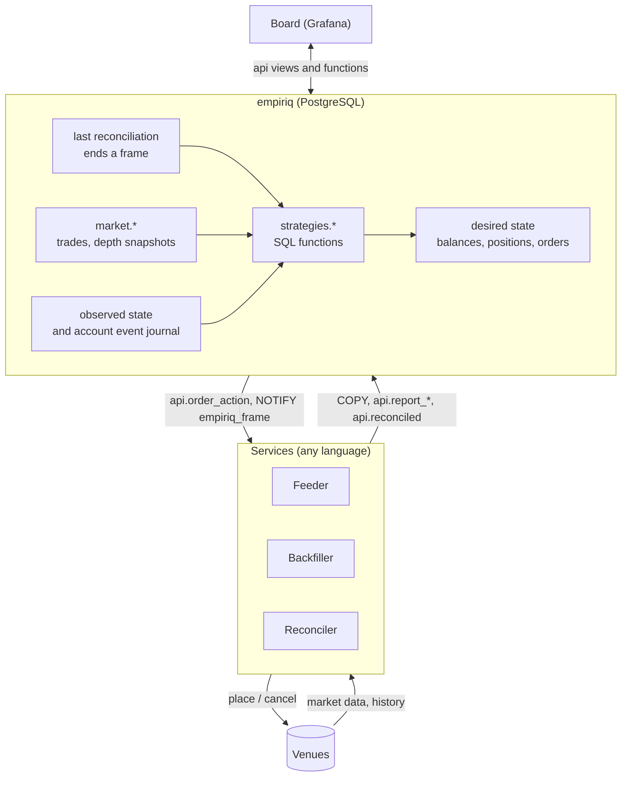
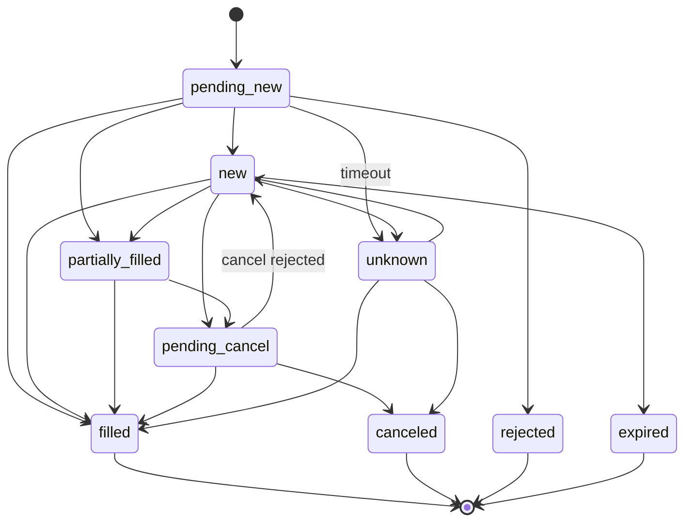

# Architecture

> Status: **draft**. Names, tables and functions will change before the first release.

empiriq is an algorithmic trading platform built around PostgreSQL. The
database holds the current state of every trading account. It also holds the
market data for these accounts. Strategies are SQL functions. Feeders,
backfillers, reconcilers and the board are separate
[services](#services). They communicate only with the database.

**Designed for:** decisions within one second or faster. Examples are market
making, arbitrage between venues, intraday strategies and portfolio
rebalancing. Backtests and research run the same code as live trading.

**The database is an investment, not only a cost.** PostgreSQL in the
decision loop adds some latency compared with an in-process engine. In return,
you get these benefits:

- The database stores every event, and you can query it later. The history for
  backtests and analysis grows while you trade.
- SQL processes large volumes of trades and depth snapshots next to the data.
  The application does not have to load the data first.
- Account state is transactional. It survives a restart of any component.
- Strategies, the board and one-off analysis use the same data.

**Not a goal:** high-frequency trading (HFT) where microseconds decide, for example
with co-location or kernel bypass. A frame takes a few transactions, so the
latency budget is in milliseconds.

## Big picture



The `database` service holds the database, in the `database` repository.
The other services have their own repositories, and they use only the public `api`
schema. See [Services](#services).

| Schema       | Purpose                                                        | Stability |
|--------------|----------------------------------------------------------------|-----------|
| `api`        | Public contract: views, functions, types                       | Versioned. Breaking changes only in major versions |
| `market`     | Market data tables that feeders write (bulk `COPY` / `INSERT`) | Versioned like `api` |
| `strategies` | User strategy functions                                        | Owned by the user |
| `core`       | Internal tables and the engine                                 | Not stable. Do not depend on it |

## Desired state and observed state

This is the central idea. It comes from Kubernetes controllers:

- **Observed state** is what the venue reports: balances, positions, orders and
  fills. Only reconcilers write it, through `api.report_*`.
- **Desired state** is what strategies want. Only the engine writes it, from
  strategy output.
- **Reconciliation** is the job of the reconciler: it makes the observed state
  match the desired state.

Strategies never call a venue. They never write observed state. Reconcilers
never make trading decisions. Because of this split, you can test strategies
in isolation, and backtests are reliable. One reconciler can also serve many
strategies.

## Frames and time

A **world** is a set of accounts with one clock: `live` or `replay`. A
**frame** is one step of a world at one `as_of`.

1. Feeders write market data all the time, not in frames.
2. The database opens a frame and sends `NOTIFY empiriq_frame`.
3. Each reconciler reconciles its accounts and calls `api.reconciled()`.
4. The last call ends the frame. The frame handler records the cutoffs, runs
   the strategies of the world and the planners. The next frame opens.

A strategy never calls `now()`. Its time is `ctx.as_of`. It sees market data
only if the venue published it by `as_of` and the row is below the cutoff of
its writer. So a replay of a frame sees the same rows, and backtests run the
same code as live trading.

[Frames, time and determinism](frames.md) describes the details.

## Declarative state: three intent kinds

A strategy can state what it wants with one of three intent kinds:

| Intent kind  | Constructor                                          | Meaning                                  | Table                   |
|--------------|------------------------------------------------------|------------------------------------------|-------------------------|
| **balance**  | `api.target_balance('BTC', 0.5, 'USDT')`             | Hold 0.5 BTC. Convert from and to USDT.  | `core.desired_balance`  |
| **position** | `api.target_position(instrument, 2)`                 | Hold a net position of +2.               | `core.desired_position` |
| **order**    | `api.limit_order('bid-1', instr, 'buy', 0.1, 64000)` | This exact order must exist.             | `core.desired_order`    |

**Planners** convert balance and position intents into orders. A planner
calculates the delta: `target − observed − in-flight`. If the delta is larger
than the tolerance, the planner adds a desired order with
`origin = 'planner'`. So reconcilers only reconcile orders. The planner does
not round to the trading rules of the venue. If the venue rejects an order,
the reconciler reports it.

The reference planners send one market order for each delta. For better
execution (TWAP, passive limit orders), replace the planner functions. Another
option is reconcilers that read the `hints` of an intent.

### Full replace

The output of one strategy run is the complete desired state of that
strategy. If the strategy sent an intent in the last frame but not in this
frame, the engine removes it. This has three consequences:

- No intent for an asset or instrument means "I no longer manage it". It does
  **not** mean "close it". To close a position, send
  `target_position(instrument, 0)`.
- The strategy identifies an order intent with its own order `key`. The same
  key with the same fields causes no action. If a field changes, the engine
  increments `revision`, and the `client_order_id` changes too. The reconciler
  then sees `cancel` for the old order and `place` for the new one. Reconcilers
  for venues with native order amendment can merge these two steps.
- A desired order is *satisfied* when its observed order is terminal, for
  example filled. The reconciler does not place it again. To trade again, use a
  new key.

### Claims

In one account, only **one strategy with one intent kind** can target an asset
or instrument. For example, a balance target on BTC funded from USDT claims
two things: `asset:BTC` and the spot instrument `BTCUSDT`. If a run conflicts
with an existing claim, it fails with a clear error. So intent kinds never
mix on one instrument. For example, a strategy cannot target a position and
also place orders on the same instrument.

### Client order ids

`client_order_id = 'eq' || strategy_id || '-' || left(md5(key), 10) || '-' || revision`

The id is deterministic, so retries are idempotent. It has at most 36
characters, which most venues accept. The `eq` prefix marks managed orders.
Reconcilers cancel foreign orders only if the account sets
`cancel_foreign_orders`.

## Order lifecycle

Observed orders follow a state machine. A trigger enforces it with the
transitions in `core.order_transition`. `filled_qty` never decreases.



Every reconciler eventually sees this case: a call to the venue times out, and nobody
knows if the venue accepted the order. The status `unknown` covers this case.
`api.order_action` returns such orders with the action `resolve`. The reconciler
must then query the venue.

## Writing a strategy

```sql
create function strategies.my_strategy(ctx api.strategy_context)
  returns setof api.intent
  language sql stable as $$ ... $$;

select api.register_strategy('my-strategy', 'main', 'strategies.my_strategy', '{"size": 1}');
select api.subscribe('my-strategy', 2, 'trade');
```

- **Signature:** `(api.strategy_context) returns setof api.intent`.
  `api.register_strategy()` checks it.
- **The function must be `STABLE`.** Then PostgreSQL rejects statements that
  change data inside it. A strategy only describes what it wants. It does not
  act.
- **Subscriptions:** subscribe to every stream that the strategy reads, with
  `api.subscribe(strategy, instrument_id, 'trade' | 'depth')`. Inside a frame,
  the helper functions raise an error for a stream without a subscription.
- **Strategy state between frames:** read it from `ctx.state`. Write it with
  the intent `api.set_state(jsonb)`.
- **Inputs:**
  - `ctx.params` and `ctx.as_of`;
  - `api.trades()`, `api.last_quote()` and `api.depth_levels()`;
  - `api.balance`, `api.position` and `api."order"`.
- **Language:** plain SQL and PL/pgSQL both work.
  `migrations/0008_example_strategies.sql` has three examples:
  - a moving average crossover (position intents);
  - a grid with strategy state (order intents);
  - a fixed holding (balance intents).

### Starting and stopping

`core.strategy` works like a Kubernetes Deployment. `desired_status` is
`running` or `stopped`, and only running strategies get strategy runs.

```sql
select api.set_strategy_status('my-strategy', 'stopped');
```

`on_stop` defines what happens to the desired state of a stopped strategy:

- `keep`: the desired state stays. Open orders stay on the venue.
- `cancel`: the engine removes the desired state. The reconciler cancels the
  open orders. Positions stay.

`api.strategy_status` shows the desired status and the result of the last
frame. To start a backtest, create a replay world with simulated
accounts, register strategies on them, start the simulated
reconcilers and call `api.start_world()`.

## Writing a feeder, a backfiller or a reconciler

Feeders, backfillers and reconcilers are long-running services.

**Feeder**

1. Register once at start with `api.register_writer(name, 'feeder', ...)`. Report the
   instruments of each venue with `api.report_instruments()`, at start and
   every hour. Write the streams
   that `api.take_work()` returns, and follow `NOTIFY empiriq_live`.
2. Write trades into `market.trade` and depth snapshots into `market.depth`.
   Use `COPY` into a staging table, then `insert ... on conflict do nothing`.
   Put the id of the writer from `api.register_writer()` into `writer_id`
   of every row. Commit the transactions for one
   instrument one after the other. This keeps `seq` in commit order for each
   writer and instrument.
3. Call `api.report_watermark(writer_id, instrument_id, stream,
   complete_until)` for each stream regularly, also when no events arrive.
   After each connect or reconnect, also pass `p_since`. The reports record
   the live coverage.

The [market data reference](../reference/market-data.md) has the field
mapping, the rules and a Go example.

**Backfiller**

A backfiller is a long-running service, like a feeder. All control goes
through SQL:

1. An operator or another service requests history with
   `api.add_history_request(instrument_id, streams, from, to)`:
   one history request for each stream.
2. The backfiller registers with `api.register_writer(name, 'backfiller', ...)`:
   its venues, streams and the settings of `api.take_work()`. Then it sends heartbeats. Like a feeder, it reports
   the instruments of its venues with `api.report_instruments()`.
3. It listens on `empiriq_history` and also checks regularly. It calls
   `api.take_work(name)` to get its next missing period, only for
   its capabilities. Each leased period is a backfill run.
4. It loads only the rows inside the leased period, in short transactions,
   with the writer from `api.register_writer()`. It
   sets `event_time = trade_time + publish_delay`, because historical sources
   have no publish time. The backfill run gives the delay, measured from live trades
   of the venue.
5. It ends the run with `api.finish_backfill(run_id, rows)`, or with an
   error text. On success the period is covered.

`api.history_coverage` shows the requested, covered and missing periods of
each stream. How a backfiller maps a period to the units of its source (for
example daily files) is its own detail. Feeders and backfillers use raw
trades, so the same trade has the same key in live and historical data, and
overlaps are safe. The
[market data reference](../reference/market-data.md#backfill) has the
details.

**Reconciler**

1. Listen on `empiriq_frame`. Each notification opens a frame of a world,
   with its `frame_id` and `as_of`. NOTIFY is only a signal: at start and
   after a reconnect, read the open reconciliations of its accounts from
   `api.reconciliation` (`reconciled_at is null`).
2. In each frame, do one pass over each of its accounts in that world:
   1. Read `api.order_action` and do each action:
      - `place`: report the order as `pending_new` with `api.report_order()`.
        Then send it to the venue.
      - `cancel`: send the cancel to the venue. Report `pending_cancel`, then
        report the result.
      - `resolve`: query the venue for the order status.
   2. Report the observed balances, positions, orders and fills.
   3. Call `api.reconciled(account_id, frame_id)`. Call it also when the
      venue did not respond. Otherwise the frame never ends.
3. Do not expect the strategies to be done when `api.reconciled()` returns.
   Today they are for the last reconciler, but the frame handler may change.
4. Always use the `client_order_id` from the database. This makes retries
   safe.

A full specification of these contracts will be part of the reference
documentation.

## Security model

| Role                 | Used by                | Permissions                                                          |
|----------------------|------------------------|----------------------------------------------------------------------|
| `empiriq_feeder`     | feeder, backfiller     | Write `market.*`, call `api.report_watermark()`                      |
| `empiriq_reconciler` | reconciler             | Read `api.order_action`, call `api.report_*` and `api.reconciled()`  |
| `empiriq_strategy`   | strategy authors, frames | Create functions in `strategies`. Read market data only through `api.trades()`, `api.last_quote()` and `api.depth_levels()`, and account views. Frames run strategies as this role. |
| `empiriq_operator`   | board, people          | Read `api.*`, change desired state through `api` functions |

All write operations use `SECURITY DEFINER` functions in `api` with a fixed
`search_path`. So clients never need privileges on `core`.

The frame handler runs inside the last `api.reconciled()` of a frame, as the
owner. The strategy itself runs
as `empiriq_strategy` through `core.call_strategy()`. It cannot read
`market.*` directly, only through the helper functions, which apply the
frame rules.
`STABLE` prevents direct writes.

> **Known gap.** `api.balance`, `api.position` and `api."order"` show all
> accounts to a strategy, not only the accounts of its world.

## Time-series storage

Feeders and backfillers store only raw events: trades in `market.trade` and
depth snapshots in `market.depth`. Functions calculate all other
values when you read them:

- strategies build bars from `api.trades()`;
- `api.trade_buckets()` groups trades for charts on the board;
- `api.last_quote()` returns the best bid and best ask;
- `api.depth_levels()` returns price levels with notional.

So all consumers see the same values. These tables and `core.fill` are plain
tables. Partitioning, retention and materialized bars come later, when real
data volumes require them.

## Services

empiriq has five services. Each service runs in its own container.

| Service      | Purpose                                                                                     | Runs as          | Repository |
|--------------|---------------------------------------------------------------------------------------------|------------------|------------|
| `database`   | PostgreSQL with the schema, the engine and `api`. **The contract** for all other services.  | Database         | `database` |
| `feeder`     | Writes live market data from one venue or data source.                                      | Long-running     | TBD |
| `backfiller` | Loads requested historical market data for backtests and analysis.                          | Long-running     | One repository for each source, for example `binance-backfiller` |
| `reconciler` | Reconciles accounts with one venue, reports observed state and ends frames. A simulated reconciler serves paper trading and backtests. | Long-running | TBD |
| `board`      | The user interface. Shows the state and changes desired state, only through `api`. Built with Grafana. | Long-running | `board` |

A deployment usually runs one feeder and one reconciler for each venue.

Each service has its own repository. The repositories are next to each other
in one directory, so that relative paths such as `../database` work:

```
empiriq/
  database/             the database service: schema, engine and api
  binance-backfiller/   a backfiller for the Binance archive
  binance-feeder/       a feeder for the Binance WebSocket streams
  board/                the board
  empiriq/              the documentation; builds the images and starts them together
```

**Images.** Each service repository has one `Dockerfile` and builds one image.
It knows nothing about the other services or about compose. The `empiriq`
repository builds all
images with `docker buildx bake`, from the repositories next to it or from
GitHub by tag, and starts them with `docker compose`.

The `empiriq` repository is not a service. All
services log in as the owner there; feeders and backfillers switch to
`empiriq_feeder` at connect, so the grants are checked. A real installation
gives each service a login with one role of empiriq.

The `empiriq` repository starts the service `database` and the other services together with
`docker compose`. The quickstart will add a simulated reconciler and an
example strategy to it. For a backtest, a
backfiller loads the requested history first.
