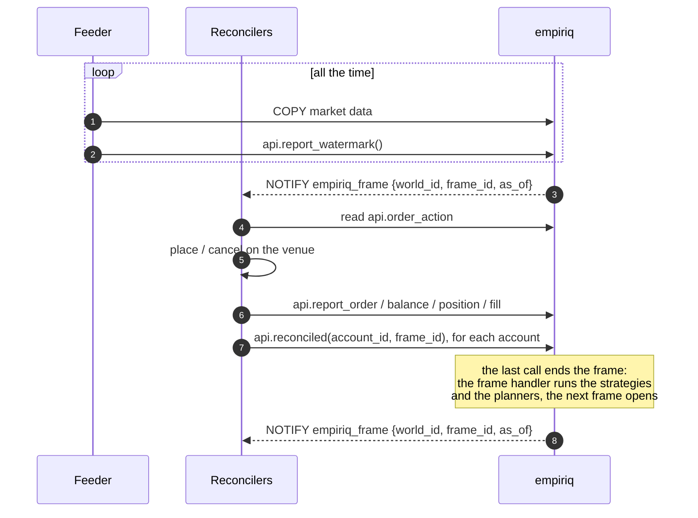

# Frames, time and determinism

This document describes how frames work now. It changes together with the
code. The reasons for the design are in the ADRs listed under
[Decisions](#decisions).

A **world** is a set of accounts with one clock. A **frame** is one step of
a world at one `as_of`. In each frame, the reconcilers reconcile every
account of the world. The last reconciliation ends the frame: the strategies
of the world run, and the next frame opens.

Two rules make a frame repeatable:

- A strategy sees only market data that the venue published by `as_of`.
- A strategy sees only rows below the cutoffs of the frame.

So a replay of a frame sees the same rows as the original frame. Backtests
and live trading run the same strategy code.

## Worlds and clocks

The **clock** of a world decides how `as_of` moves.

| Clock    | Accounts                                             | `as_of` of a new frame                       | Market data                      |
|----------|------------------------------------------------------|----------------------------------------------|----------------------------------|
| `live`   | Real venues, or simulated accounts for paper trading | `clock_timestamp()`                          | Feeders, in real time            |
| `replay` | Simulated fills against history                      | The previous `as_of` + the step of the world | Backfillers, before the backtest |

- Each account belongs to one world (`core.account.world_id`).
- Several replay worlds can run next to a live world in one database. All
  worlds share the market data.
- The owner creates worlds and their accounts in SQL (`core.world`). An
  operator starts a world with `api.start_world(world_id, as_of)`. A replay
  world starts at `as_of`. A live world ignores `as_of` and starts now.
- A replay world ends after the frame at `replay_to`.
- An account that joins a world takes part from the next frame.
- A world without accounts has no frames.

A backtest needs no feeder. Request the history with
`api.add_history_request()` before the backtest starts. Then create a replay
world with simulated accounts, register the strategies, start the simulated
reconcilers and call `api.start_world()`.

## The life of a frame

1. Feeders write the streams of the active live requests all the time, not
   in frames. For each stream they also report a watermark with
   `api.report_watermark()`, also when the market is quiet.
2. The database opens a frame (`core.frame`). It opens one reconciliation for
   each account of the world and sets `pending` to the number of accounts.
   Then it sends `NOTIFY empiriq_frame {world_id, frame_id, as_of}`.
3. Each reconciler sends the order actions to the venue and reports the
   observed state. Every report also goes into the account event journal.
4. For each of its accounts, the reconciler calls
   `api.reconciled(account_id, frame_id)`. It calls it also when the venue
   did not respond. A second call for the same account and frame is an
   error.
5. The call that sets `pending` to 0 ends the frame. In its transaction, the
   database calls the frame handler `core.on_frame(frame_id)`, opens the next
   frame and sends `NOTIFY empiriq_frame`.

`api.reconciled()` decrements `pending` with one `update ... returning`. The
row lock orders concurrent calls, so exactly one transaction sees 0.

### The frame handler

`core.on_frame()` does three things, in this order:

1. It records the cutoffs of the frame (see [Cutoffs](#cutoffs-and-writers)).
2. It runs each running strategy of the world. Each run is a strategy run
   (`core.strategy_run`) in its own subtransaction. If a run fails, its
   strategy keeps its previous desired state. `api.strategy_run` shows the
   error.
3. It runs the planners of each account.

## Logical time

A strategy never calls `now()`. Its time is `ctx.as_of`. `api.now()` returns
the same value from a setting that the engine sets for the transaction.

- `as_of` increases from frame to frame of a world. Two frames of a world
  never have the same `as_of`.
- Market data is visible only after the venue **published** it:
  `event_time <= as_of`. The `trade_time` of a trade only puts the trade into
  a period. It never controls visibility.
- A strategy builds bars from `api.trades()`. It uses only periods that are
  closed at `as_of`: a period that starts at `ts` is complete at
  `ts + interval`. The [market data reference](../reference/market-data.md)
  has the details.

## Cutoffs and writers

Every row of `market.trade` and `market.depth` has a `writer_id` and a `seq`.
A **writer** is one feeder or backfiller process. It registers with
`api.register_writer()` and keeps one writer for the life of the service.
`seq` grows in commit order for each writer and instrument, because a writer
commits its transactions for one instrument one after the other.

When a frame ends, before its strategies run, the frame handler records the
**cutoffs** of the frame (`core.frame_cutoff`). There is one cutoff for each
stream that a running strategy of the world subscribed to and each writer
with rows in that stream: the highest `seq` of that writer.

Inside a frame, a row is visible only if both conditions are true:

- `event_time <= as_of`;
- `seq <=` the cutoff of its writer.

Rows of a writer without a cutoff are invisible. A row that reaches the
database after the frame ended is invisible in the frame and in its replay.
This is true also when a feeder and a backfiller write the same stream at the
same time.

Frames of both clocks record cutoffs. So a backtest stays repeatable also
when a backfill loads history while the backtest runs.

The index `(instrument_id, writer_id, seq)` makes a cutoff one index lookup.

## Subscriptions

A strategy lists the streams that it reads with
`api.subscribe(strategy, instrument_id, 'trade' | 'depth')`
(`core.strategy_stream`). The frame handler records cutoffs only for these
streams. Inside a frame, `api.trades()`, `api.last_quote()` and
`api.depth_levels()` raise an error for a stream without a subscription.

## The account event journal

A reconciler reports events with an `event_time`: order accepted, order
rejected, fill, balance change and position change. `core.account_event`
stores each event. The tables of observed state change in the same report.
A reconciliation stores the `seq` of the last account event, so you know
which account events a frame was based on.

## Properties

- **No scheduler.** The slowest reconciler of a world sets its rhythm. In a
  replay world, simulated reconcilers respond at once, so the world runs as
  fast as the database.
- **One `as_of` for all accounts of a world.** A strategy sees all accounts
  of its world at the same `as_of`.
- **The slowest venue of a world** sets the rhythm for all strategies of that
  world. Other worlds do not wait.
- **Every frame needs every reconciler.** A reconciler that stops or hangs
  stops its world.
- **Quiet markets.** Frames run also when no new data arrived. A stale
  watermark shows a broken feeder.
- **Slow strategies.** The frame handler runs in the transaction of the last
  `api.reconciled()`. A slow strategy makes that reconciler slow.

## Limits

- **Exact replay.** Cutoffs make market data repeatable. Strategies still
  read the current observed state, not the state as of the frame.
- **Strategies with more than one account.** How a strategy sends intents to
  several accounts of its world is open.
- **A reconciler that hangs** stops its world. There is no deadline yet.

See open questions 1, 2 and 5 in the [architecture](architecture.md#open-questions).

## Decisions

| ADR | Why |
|-----|-----|
| [0005](../adr/0005-logical-time.md) | Logical time instead of the wall clock, and visibility by publication time. |
| [0008](../adr/0008-frames.md) | Reconciliations drive frames instead of a scheduler. Cutoffs make frames repeatable. |
| [0009](../adr/0009-writers.md) | One cutoff for each writer, so several writers can write one stream. |
| [0022](../adr/0022-frames-belong-to-a-world.md) | A frame is a step of a world, not of one account. |
| [0003](../adr/0003-cycle-barrier.md) | Superseded: a global cycle with a barrier. |
